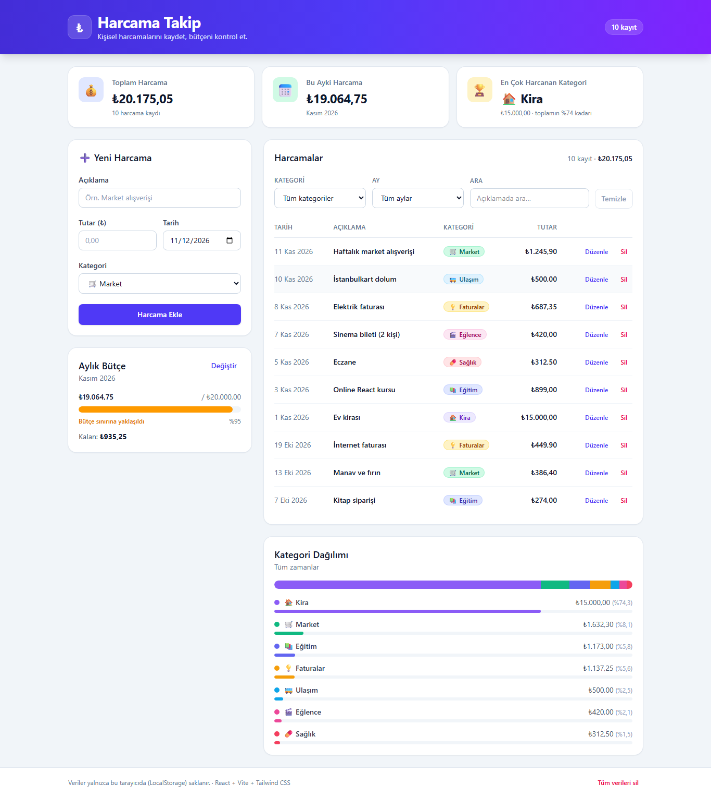
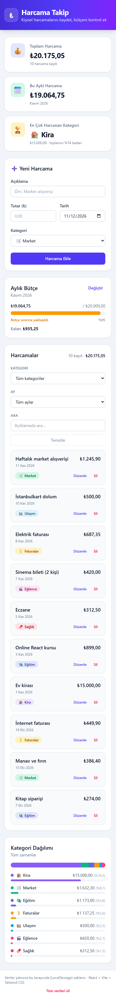
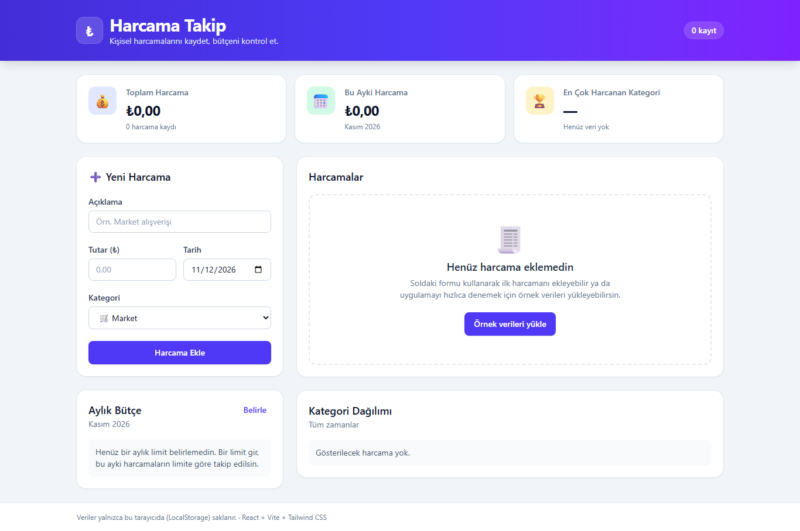

# 💰 Harcama Takip

Kişisel harcamaları kaydetmek, kategorilere ayırmak ve aylık bütçeyi takip etmek için geliştirilmiş, **React + Vite** ile yazılmış tek sayfalık bir web uygulaması. Tüm veriler tarayıcının **LocalStorage** alanında saklanır; hesap açmaya veya sunucuya gerek yoktur.


- 🔗 **GitHub Deposu:** https://github.com/Bayraktarsss/SWPharcama-takip
- 🌐 **Canlı Demo:** https://keen-centaur-62c50e.netlify.app/

---

## 📸 Ekran Görüntüleri

**Masaüstü görünümü**



**Mobil görünüm** ve **boş durum (örnek veri yükleme)**

<p>
  
  &nbsp;
  
</p>

---

## ✨ Özellikler

- **Harcama ekleme formu:** açıklama, tutar, kategori ve tarih alanları; anlık doğrulama ve hata mesajları.
- **Harcama listesi:** masaüstünde tablo, mobilde kart görünümü; her kategori için **renkli rozet**.
- **Düzenleme ve silme:** kayıt düzenlenirken form ve satır vurgulanır, silmeden önce onay istenir.
- **Özet kartları:** toplam tutar, bu ayki harcama ve en çok harcanan kategori.
- **Filtreleme:** kategoriye, aya ve açıklamada metin aramasına göre; filtrelenmiş toplam gösterilir.
- **Kategori dağılımı:** ek kütüphane kullanmadan, saf CSS ile çizilmiş yığılmış ve yatay çubuklar.
- **Aylık bütçe limiti:** ilerleme çubuğu %80'de turuncu, %100'de kırmızıya döner; kalan / aşım tutarı gösterilir.
- **Kalıcı veri:** `useLocalStorage` özel hook'u ile tüm veriler sayfa yenilense de korunur.
- **Türkçe biçimlendirme:** `Intl.NumberFormat('tr-TR')` ile ₺ para birimi, Türkçe tarih ve ay adları.
- **Örnek veriler:** boş ekranda "Örnek verileri yükle" düğmesi ile uygulama tek tıkla doldurulabilir.
- **Duyarlı ve erişilebilir tasarım:** mobil uyumlu düzen, etiketli form alanları, `aria` öznitelikleri, klavye odak halkaları.

## 🛠️ Kullanılan Teknolojiler

| Teknoloji | Kullanım amacı |
|-----------|----------------|
| [React 19](https://react.dev/) | Bileşen tabanlı kullanıcı arayüzü, `useState` / `useEffect` / `useMemo` hook'ları |
| [Vite](https://vite.dev/) | Geliştirme sunucusu ve üretim derlemesi |
| [Tailwind CSS v4](https://tailwindcss.com/) (`@tailwindcss/vite`) | Yardımcı sınıflarla duyarlı stil |
| LocalStorage (Web Storage API) | Harcamaların ve bütçe ayarının tarayıcıda saklanması |
| Intl API | Türk lirası ve tarih biçimlendirme |
| Netlify | Yayına alma (`netlify.toml` hazır) |
| Claude / Claude Code | Planlama, kod üretimi, hata ayıklama, dokümantasyon |

## 🚀 Kurulum ve Çalıştırma

Gereksinim: [Node.js](https://nodejs.org/) 20 veya üzeri.

```bash
# 1. Depoyu klonla
git clone https://github.com/Bayraktarsss/SWPharcama-takip
cd 3_Web_Projesi

# 2. Bağımlılıkları yükle
npm install

# 3. Geliştirme sunucusunu başlat (http://localhost:5173)
npm run dev

# 4. Üretim derlemesi al (çıktı: dist/)
npm run build

# 5. Derlenmiş sürümü yerelde önizle
npm run preview
```

### Yayına alma (Netlify)
Depo Netlify'a bağlandığında `netlify.toml` dosyası sayesinde ayar gerekmez:
- **Build command:** `npm run build`
- **Publish directory:** `dist`

Alternatif olarak `npm run build` sonrası oluşan `dist` klasörü Netlify Drop'a sürüklenerek de yayınlanabilir.

## 📁 Proje Yapısı

```
3_Web_Projesi/
├── docs/
│   └── PLANLAMA.md            # Yapay zeka ile yapılan planlama (fikir, ekranlar, veri modeli)
├── public/
│   └── favicon.svg
├── screenshots/               # README ekran görüntüleri
├── src/
│   ├── components/
│   │   ├── BudgetCard.jsx         # Aylık bütçe ve ilerleme çubuğu
│   │   ├── CategoryBadge.jsx      # Renkli kategori rozeti
│   │   ├── CategoryBreakdown.jsx  # Saf CSS kategori dağılımı
│   │   ├── EmptyState.jsx         # Boş liste / boş filtre ekranı
│   │   ├── ExpenseForm.jsx        # Ekleme + düzenleme formu
│   │   ├── ExpenseList.jsx        # Tablo (masaüstü) ve kartlar (mobil)
│   │   ├── Filters.jsx            # Kategori / ay / arama filtreleri
│   │   ├── Header.jsx
│   │   └── SummaryCards.jsx       # Üstteki özet kartları
│   ├── hooks/
│   │   └── useLocalStorage.js     # LocalStorage ile senkron state
│   ├── utils/
│   │   ├── categories.js          # Kategori listesi ve renkleri
│   │   ├── format.js              # Para, tarih, ay biçimlendirme
│   │   ├── sampleData.js          # Örnek veriler
│   │   └── stats.js               # Toplam ve dağılım hesapları
│   ├── App.jsx
│   ├── index.css                  # Tailwind girişi ve genel stiller
│   └── main.jsx
├── index.html
├── netlify.toml
├── package.json
└── vite.config.js
```

### Veri modeli (özet)

```js
// LocalStorage: "harcama-takip:harcamalar"
{ id: "uuid", aciklama: "Market alışverişi", tutar: 1245.9, kategori: "Market", tarih: "2026-11-11", olusturma: 1762857600000 }

// LocalStorage: "harcama-takip:aylik-butce"
20000
```

Ayrıntılı plan için: [docs/PLANLAMA.md](docs/PLANLAMA.md)

---

## 🤖 Yapay Zeka Kullanımı

Projede yapay zeka asistanı olarak **Claude** (Anthropic) ve terminal/IDE içinde çalışan **Claude Code** kullanıldı. Proje, Claude ile birlikte planlandı ve geliştirildi; üretilen her kod parçası okunup çalıştırılarak, tarayıcıda denenerek ve `npm run build` ile doğrulanarak projeye alındı. Aşağıda hangi aşamada nasıl kullanıldığı ve örnek istemler yer alıyor.

### 1. Planlama (fikir, ekranlar, veri modeli)
Kodlamaya başlamadan önce fikir seçimi, ekran düzeni ve veri modeli Claude ile tartışıldı. Sonuçlar [docs/PLANLAMA.md](docs/PLANLAMA.md) dosyasına yazıldı.

> **İstem:** "React ve LocalStorage kullanan bir harcama takip uygulaması planlıyorum. Hangi ekranlar olmalı, bir harcama kaydında hangi alanlar bulunmalı ve LocalStorage'da veriyi nasıl bir yapıda saklamalıyım? Tablo halinde öner."

> **İstem:** "Toplam, bu ayki harcama ve en çok harcanan kategori gibi değerleri LocalStorage'a ayrıca kaydetmeli miyim, yoksa her seferinde hesaplamak mı daha doğru?"
> *(Sonuç: türetilen değerler saklanmıyor, `useMemo` ile hesaplanıyor.)*

### 2. Bileşen üretimi
Yönergedeki Vue örneği React'e uyarlanarak bileşenler tek tek ürettirildi, ardından proje yapısına göre düzenlendi.

> **İstem:** "React ve Tailwind CSS ile harcama ekleme formu ve altında harcama tablosu tasarla. Kategorilere renkli rozetler ver, üstte toplam tutarı gösteren bir özet kartı olsun. Veriler LocalStorage'a kaydedilsin."

> **İstem:** "useState gibi çalışan ama değeri LocalStorage'da saklayan bir useLocalStorage hook'u yaz. Bozuk JSON veya gizli sekme gibi hata durumlarında uygulama çökmesin."

> **İstem:** "Grafik kütüphanesi kullanmadan, sadece CSS ile kategori bazında harcama dağılımını gösteren yatay çubuklar çiz."

### 3. Hata ayıklama
> **İstem:** "Düzenle'ye bastığımda form eski harcamanın bilgileriyle dolmuyor, ilk açılıştaki değerler kalıyor. Neden olabilir?"
> *(Açıklama: `useState` başlangıç değeri yalnızca ilk render'da okunur. Çözüm: forma `key={duzenlenen?.id ?? 'yeni'}` verilerek düzenleme başladığında bileşenin yeniden oluşturulması.)*

> **İstem:** "Tarihi `new Date('2026-11-01')` ile biçimlendirince bazen bir gün önceki tarih görünüyor. Bunu nasıl düzeltirim?"
> *(Açıklama: ISO tarih metni UTC olarak yorumlanıyor; tarih parçalanıp yerel saatle `new Date(yıl, ay - 1, gün)` oluşturularak düzeltildi.)*

### 4. Kod açıklama
> **İstem:** "Intl.NumberFormat ile 'tr-TR' ve 'TRY' kullandığımda çıktı neden '₺1.234,50' oluyor? Seçenekleri tek tek açıklar mısın?"

> **İstem:** "useMemo'yu bu projede nerelerde kullanmak mantıklı, nerelerde gereksiz?"

### 5. Stil önerileri ve erişilebilirlik
> **İstem:** "Bu tablo mobilde taşıyor. Tailwind ile küçük ekranlarda tablo yerine kart görünümüne geçen duyarlı bir tasarım öner."

> **İstem:** "Bütçe ilerleme çubuğu için renk eşikleri ve ekran okuyucular için uygun aria öznitelikleri öner."

### 6. Dokümantasyon
Bu README ve planlama dokümanının taslağı Claude ile hazırlandı, ardından proje içeriğine göre gözden geçirildi.

### Değerlendirme ve öğrenilenler
- Yapay zekanın ürettiği kod doğrudan kopyalanmadı; her bileşen çalıştırılıp tarayıcıda test edildi, gerektiğinde istem düzeltilerek tekrar istendi.
- **Net ve bağlam içeren istemler** (teknoloji, kısıtlar, beklenen çıktı biçimi) çok daha kullanılabilir sonuçlar verdi.
- Hata ayıklamada yalnızca çözümü değil **hatanın nedenini** sormak, React'in `state` ve `key` mantığını daha iyi anlamamı sağladı.

---

## 📄 Lisans

Bu proje eğitim amaçlı hazırlanmıştır.
